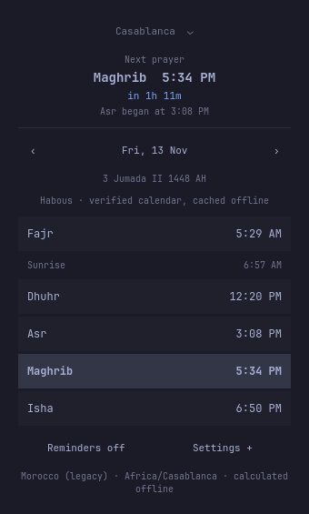

# Prayer Times for Omarchy

A compact prayer panel with offline prayer calculations and authoritative Hijri synchronization inspired by Omarchy’s World Clock. Five prayer rows, a secondary sunrise time, the next-prayer countdown, and small inline controls. No account, geolocation tracking, Qibla, or separate application window. Hijri synchronization makes a fixed HTTPS request to the selected supported authority; it sends no coordinates.



## Requirements

Targets **Omarchy 4.5.0-3 and its built-in bar**, on Linux. Older Omarchy releases and replacement bars are not currently supported. Requires Python 3.9+, the system IANA timezone database (`tzdata`), Quickshell and the standard Omarchy notification command. These are available on the tested Omarchy installation. Optional audio requires `mpv`; the panel reports when it is missing. No pip packages, downloaded scripts, privileged installer, background system service or account is used. The optional Hijri display uses HTTPS to fetch official calendar evidence.

## Install and configure

```sh
omarchy plugin add https://github.com/hassanaitnacer/omarchy-prayer-times.git --enable
```

Open the mosque icon in the bar. Choose an offline reference city, or enter a city label, precise latitude/longitude and IANA timezone in Settings → Location. Reference-city coordinates may be far from your actual location: review them before confirming. In Settings → Calculation, choose the method, Asr rule and high-latitude rule used by your community. Review the displayed location and method, then select **Confirm location and method**.

Prayer times and reminders remain inactive until setup is confirmed. Reminders then default to on; sound and advance reminders default to off. Invalid location settings pause reminders and audio until corrected. Check the calculated times against your local timetable and use per-prayer adjustments when needed. No single calculation method is guaranteed to match every published timetable.

## Update, disable and remove

```sh
omarchy plugin update io.github.hassanaitnacer.prayer-times
omarchy plugin disable io.github.hassanaitnacer.prayer-times
omarchy plugin enable io.github.hassanaitnacer.prayer-times
omarchy plugin remove io.github.hassanaitnacer.prayer-times
```

Use the standard commands to stop/unload the plugin before removal. Removal deletes the installed checkout; keep development work in a separate repository. Settings and notification history can remain after removal. History is deliberately retained to prevent duplicate reminders after reinstallation. If you want to erase that history too, remove only `~/.local/state/omarchy/prayer-times/` (or `$XDG_STATE_HOME/omarchy/prayer-times/`) after disabling/removing the plugin.

## Settings and development

Settings live in the `io.github.hassanaitnacer.prayer-times` bar entry in `~/.config/omarchy/shell.json`. Notification delivery history, an optional generated chime, and the validated Hijri calendar cache live in the state directory described above. The plugin writes its own settings and state only; it does not change the system timezone or install other programs. Audio is played from a user-selected local file or the original generated chime; no recording is bundled.

The development repository and installed checkout should be separate ordinary directories. Do not put symlinks inside the plugin. Test changes in the development repository, then install/update through Omarchy. After changing QML file structure, run `omarchy restart shell` from a desktop terminal if Qt reports a cached “File name case mismatch”.

The unpublished predecessor used `hassan.prayer-times`. When migrating such an installation, back up its source and `shell.json`, preserve its effective location/calculation settings, and replace its bar entry with the new ID. Do not enable both versions: they share reminder history. Fresh community installations do not need this migration.

## Everyday use

- Left-click the bar to open the panel. Right-click switches between the next-prayer label and a compact mosque icon. Vertical bars use the icon.
- Click the location to search the **offline IANA timezone reference-city catalogue**. These are reference cities, not a complete world-city database. Choose manual coordinates for your precise location or any missing city. Confirm the suggested calculation profile. This changes only the plugin’s timezone.
- Previous/next arrows browse up to a year each way. Click the displayed date to return to today. The hero countdown always refers to the actual next prayer, even while browsing another day.
- Click a prayer time, or press `T`, to toggle 12/24-hour time. The initial format follows Omarchy’s language locale.
- `N` toggles reminders, `F` toggles the fasting countdown, and `S` expands settings. Tab/Shift+Tab navigate controls; Enter/Space activate buttons; left/right arrows browse days outside editors. Escape closes the current inline interaction first.
- Settings save inline. Advanced settings are grouped into Location, Calculation, Reminders, Sound, and Display. Numerical changes commit when leaving the field or pressing Enter.
- Optional fasting mode shows the next Fajr (Suhoor) or Maghrib (Iftar) countdown. It is available year-round and does not track fasting history.
- The Hijri label uses **authoritative synchronized dates**, not a manual offset or an astronomical prediction. Settings → Display selects the calendar authority. Automatic selection currently supports Habous for `Africa/Casablanca` and `Africa/El_Aaiun`; selecting Habous explicitly lets a user follow Morocco’s calendar elsewhere. Other authorities are not yet integrated and show **unverified**. Disabling synchronization stops new requests.

## Authoritative Hijri dates

The [Moroccan Ministry of Habous](https://www.habous.gov.ma/) publishes explicit Hijri/Gregorian date pairs in its official announcements. `hijri_sync.py` reads only those paired dates from the ministry’s HTTPS page; it does not treat a generic conversion API as Morocco’s official calendar. This is a website adapter, not a ministry-provided API, so format changes can make synchronization unavailable.

After setup, one background worker checks the fixed source URL at most once per hour per process. Requests have a 10-second socket timeout, a 1 MiB response limit, and HTTPS redirects restricted to the Habous hosts. No user location, settings or audio file path is sent. Confirmed dates are cached in `calendar-habous.json` in the plugin’s XDG state directory. The display distinguishes synchronized, cached, unavailable, unsupported and disabled states. A failed fetch never blocks prayer calculations or reminders.

A published date establishes that month’s start. The civil Hijri date advances at midnight in the selected timezone. The plugin can derive days 1–29 from that official start; it requires explicit evidence for day 30 or the next month. Beyond verified coverage it shows **unverified**, never a guessed date. An expired or changed source cannot silently extend an old month. The first supported authority is Morocco’s Habous; worldwide prayer calculations do not imply worldwide official Hijri coverage.


English, Arabic (including mirrored layout), and French follow Omarchy’s live language. Other languages fall back to English. Layout, palette, fonts and popup motion follow Omarchy.

## Calculation contract

Schedules are computed offline, using the selected city’s IANA timezone, including daylight-saving transitions and dates across the international date line. They are **not guaranteed to match a mosque or government timetable**. The Morocco profile deliberately preserves the original plugin’s calculations; it is not labelled as an official Habous timetable.

| Profile | Fajr angle | Isha | Built-in margins |
| --- | --- | --- | --- |
| Morocco (legacy) | 19° | 17° | Sunrise −3m, Dhuhr +5m, Maghrib +5m |
| Muslim World League | 18° | 17° | Dhuhr +1m |
| ISNA | 15° | 15° | Dhuhr +1m |
| Egyptian | 19.5° | 17.5° | Dhuhr +1m |
| Karachi | 18° | 18° | Dhuhr +1m |
| Umm al-Qura | 18.5° | 90m after sunset; 120m in calculated Ramadan | None |
| Custom angles | Configurable, initially 19° | Configurable, initially 17° | Legacy Morocco margins |

Per-time adjustments add −60 to +60 minutes to the selected profile’s margins. Standard and Hanafi Asr use shadow factors 1 and 2. The Umm al-Qura Ramadan interval uses the selected authoritative calendar when a verified date is available. When it is unavailable, this offline interval uses the existing calculated calendar and Isha is explicitly marked `≈`; it is not represented as an official Saudi timetable. The displayed Hijri date itself never falls back to that estimate. Its fixed Isha interval is measured from the calculated sunset before user Maghrib/Isha adjustments.

High-latitude options are none, middle of the night, one seventh of the night, or an angle-based portion. Estimated times carry `≈`. These rules need an actual sunset and sunrise; polar-day/night events that cannot be calculated remain `—`. No substitute latitude or invented polar timetable is silently applied.

Existing custom angles, Asr factor, adjustments, notification preference, and display preference are retained. Existing configurations without a timezone use Casablanca for the original default location, otherwise the system timezone used by v1; the first valid load persists that zone. Choosing a named profile explicitly replaces custom angles, while retaining user per-time adjustments.

Sources and independent references:

- [PrayTimes astronomical calculation](https://praytimes.org/docs/calculation).
- [Adhan calculation profiles](https://github.com/batoulapps/adhan-js/blob/develop/src/CalculationMethod.ts), [high-latitude rules](https://github.com/batoulapps/adhan-js/blob/develop/src/CalculationParameters.ts), and [independent expected-time fixtures](https://github.com/batoulapps/adhan-js/blob/develop/test/adhan.test.ts).
- [Unicode ICU Islamic civil calendar](https://github.com/unicode-org/icu/blob/main/icu4c/source/i18n/islamcal.cpp).
- The system’s `/usr/share/zoneinfo/zone.tab` supplies offline reference-city coordinates; `zoneinfo` supplies civil-time rules.

## Reminders and audio

One shared plugin service handles every monitor. Delivered-event identifiers persist in `~/.local/state/omarchy/prayer-times/delivered.json`; a file lock prevents overlapping reloads from dispatching the same event. Failures remain visible in the panel and can retry while an event is recent.

After setup confirmation, prayer reminders start enabled, audio and advance reminders disabled. Each prayer can be muted. Optional advance reminders default to 10 minutes (adjustable 1–60). Following sleep or startup, only the latest enabled prayer within the previous 15 minutes is eligible, with no catch-up audio. Missed advance reminders are not replayed. Notifications use a distinct app identity and transient delivery, respecting Omarchy’s Do Not Disturb without queuing a later backlog.

Choose an original locally generated chime or an existing local Adhan file. Use the full file path, set volume, and preview. Stop is available in the panel and on audible prayer notifications. Audio is disabled when Do Not Disturb is on or its status cannot be established. Turning off sound/reminders, changing location, or exiting/reloading the worker stops playback. Audio also stops after 20 minutes as a playback limit. The plugin does not stream audio or bundle third-party recordings.

The shell must be running for reminders. It does not wake or power on the computer. Atomic history greatly reduces duplicate delivery, but an abrupt failure between the notification daemon accepting a message and its history commit cannot provide a mathematical exactly-once guarantee.

## Implementation and checks

- `engine.py`: pure prayer calculations, timezone/date conversion, profile validation and reminder eligibility.
- `hijri_sync.py`: bounded HTTPS retrieval, strict official date-pair validation and cached calendar coverage.
- `backend.py`: one standard-library worker, JSON-lines protocol, durable notification history and local audio ownership.
- `Service.qml`: native singleton service owning the worker. Settings are explicitly supplied by the bar widget; notification dispatch waits for configuration.
- `Panel.qml`, `Settings.qml`, `PlainText.qml`, `Model.js`: native UI, inline settings and small display helpers.
- `i18n/`: complete English/Arabic/French plugin catalogs.

```sh
PYTHONDONTWRITEBYTECODE=1 python3 -m unittest discover -s tests -p 'test_*.py'
node --test tests/*.mjs
omarchy plugin validate .
python3 tests/ui_smoke.py /tmp/prayer-ui-results
```

The tests include independent ISNA/MWL/Egyptian times, a full year of ordering, legacy Casablanca values, Hijri boundaries, Morocco’s Ramadan timezone transition, a repeated DST hour, the international date line, polar unavailability, high-latitude estimates, restart/concurrency deduplication, short-suspend audio suppression, failed-delivery retry, and markup-shaped input.

The UI smoke check renders the actual panel content and native controls in English, French and Arabic. It substitutes only the compositor popup window with an offscreen adapter. Real compositor placement, physical suspend/resume, desktop notification delivery, and speaker output still require a running desktop session; the preview does not claim to test those integrations.
